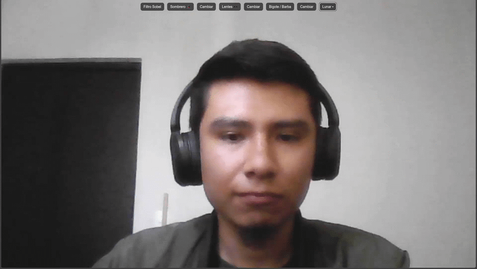

# Filtros faciales en el navegador con MediaPipe y Sobel

Aplicaciones web que usan la cámara para **detectar el rostro en tiempo real** y aplicar efectos sobre él, sin instalar nada: todo corre en el navegador.


## Demo



## Proyectos

### 1. Filtro de accesorios interactivo (`Filtro/`)
- Detección de los puntos del rostro con **MediaPipe Face Mesh**.
- Accesorios que siguen la cara en tiempo real: sombreros, lentes, bigotes y barbas, y lunar, con botones para activar cada uno y cambiar de modelo.
- **Filtro de detección de bordes Sobel** programado a mano: convolución con los kernels horizontal y vertical sobre los píxeles del *canvas*.

### 2. Malla facial (`index.html`)
- Dibuja en un *canvas* los puntos de la malla facial detectados sobre el video de la cámara.

## Cómo ejecutarlo

La cámara solo funciona desde `localhost` o HTTPS, así que hay que levantar un servidor local:

```bash
python -m http.server 8000
```

Después abre <http://localhost:8000/Filtro/> y permite el acceso a la cámara.

## Conceptos aplicados

- Convolución 2D y gradiente de intensidad (operador de Sobel)
- Manipulación de píxeles con `ImageData` en Canvas
- Detección de *landmarks* faciales con modelos preentrenados
- Captura de video con `getUserMedia`

## Autor

**Juan Alexis Martínez Morán** – Materia de Métodos Numéricos, Universidad Cuauhtémoc Querétaro
